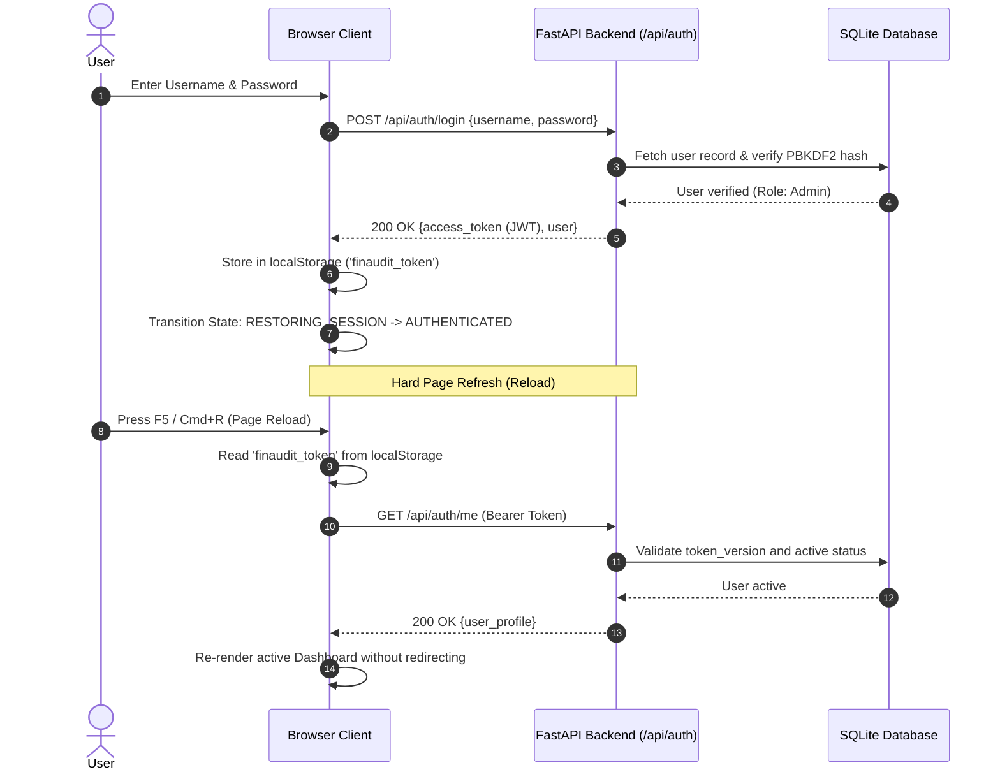

# 05 — Technical Architecture & Data Flow

**Document**: System Architecture Specification  
**Application**: FinAuditPro (TempAudit)  
**Version**: 1.0.0  

---

## 1. High-Level Architecture Diagram

```mermaid
graph TD
    User([Chartered Accountant / Auditor]) -->|HTTPS / Localhost| UI[Vanilla JS Single-Page Application]
    
    subgraph Frontend [Presentation Layer (HTML5/CSS3/ES6)]
        UI --> Router[Client Route Dispatcher]
        Router --> AuthState[Session State Machine & Token Manager]
        Router --> DOMRender[DOM View Renderers - 21 Screens]
        AuthState --> APIClient[FinAuditAPI Client & Token Signer]
    end

    APIClient -->|JSON REST Requests| Backend[FastAPI Server :8000]

    subgraph BackendApp [Local Backend Services]
        Backend --> CORS[CORS & Request Gatekeeper]
        CORS --> AuthRouter[JWT Auth & RBAC Middleware]
        AuthRouter --> EngScope[Engagement Scoping Layer]
        
        EngScope --> IngestService[File Ingestion & Parser Service]
        EngScope --> AuditEngines[Tri-Engine Forensic Core]
        EngScope --> ReconEngine[BRS & GST Reconciliation]
        EngScope --> ReportService[ReportLab PDF Engine]
        
        subgraph TriEngine [Forensic Analysis Core]
            AuditEngines --> DetEngine[Deterministic Rule Engine - Sec 40A3, 269ST, GSTIN]
            AuditEngines --> MLEngine[Scikit-Learn Isolation Forest & Benford MAD]
            AuditEngines --> LocalAIEngine[Local LM Studio Redacted Context Assistant]
        end
        
        subgraph AuditLogging [Cryptographic Provenance]
            EngScope --> AuditLogger[Sequential SHA-256 Hash Chain Logger]
        end
    end

    IngestService --> DB[(SQLite Embedded Database)]
    AuditEngines --> DB
    ReconEngine --> DB
    AuditLogger --> DB
    
    BackendApp -.->|Offline / Localhost:1234| LMStudio[LM Studio / Local LLM Server]
```

---

## 2. Authentication & Session Lifecycle



---

## 3. Data Ingestion & Audit Pipeline

```mermaid
flowchart TD
    A[Upload CSV / XLSX] --> B[UUID File Isolation in backend/uploaded_files/]
    B --> C[Column Mapping Discovery & Alias Matcher]
    C --> D{Validation Check}
    D -- Invalid Rows --> E[Generate Error Report CSV - Rollback DB]
    D -- Valid Rows --> F[Bulk Insert Transactions with Engagement ID]
    F --> G[Trigger Deterministic Engine]
    G --> H[Check Mathematical Balance Total Dr == Total Cr]
    G --> I[Check Section 40A(3) Payments > ₹10,000]
    G --> J[Check Section 269ST Receipts >= ₹2,00,000]
    J --> J1[Condition a: Daily Person Limit]
    J --> J2[Condition b/c: Multi-date Transaction/Event Limit]
    G --> K[Log Audit Findings with Source IDs]
    K --> L[SHA-256 Audit Trail Event Hash Generated]
```

---

## 4. Bank Reconciliation Source Separation

To prevent self-reconciliation bugs, the BRS engine strictly partitions database records:
- **Book Side**: Strictly excludes records with `transaction_type IN ('BANK_STATEMENT', 'BANK STATEMENT', 'BANK')` or originating from files categorized as Bank Statements.
- **Bank Side**: Fetches exclusively records tagged under `BANK_STATEMENT` or matching statement file IDs.
- **Result**: Book transactions and statement transactions never overlap, guaranteeing clean multi-tier matching.
